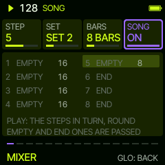

# Sardine

Live club mixing for the FM-1, four layers packed in one can.

Sardine is a custom firmware for the M-VAVE FM-1. Four layers, always there: LEAD, CHORD, BASS and DRUMS. PRESETS
takes you from one to the next, FX through a layer's pages, and HOME back to all of them playing. A layer's sound acts
at once; its pattern, steps and modifiers (FAST, SLOW, REV, EVERY, THIN, EUCLID, SHIFT, LEN, OCT, PLY) wait, in the
second colour, until SEQ drops them in on the one.

## What it does

**The layers**

- LEAD, CHORD and BASS: 81 synth sounds on Felucca's engines (bass, keys, pads, leads, FX, and an AMBIENT set of wide
  pads, dub stabs and a rumbling bass in a big hall), each with CUTOFF, RESO, DRIVE and ENV on its home page
- DRUMS: seven rows (KICK, SNARE, CLAP, HATS, TOMS, RIM, PERC) that never cut each other off, eight variations of each
  drum, 24 synthesised kits (four with the kick tuned to the key); PERC is tambourine, bongo, wood block, cowbell, cabasa and zap; no cymbals, no samples
- 24 drum patterns and 29 synth patterns, straight, broken and triplet; FEEL swings them all together; ten modifiers
  (FAST, SLOW, REV, EVERY, THIN, EUCLID, SHIFT, LEN, OCT, PLY) bend any of them
- An arpeggiator on every synth layer, off until you want it: ten modes, triplet rates, up to four octaves
- Key, scale and ten chord progressions; every synth layer follows the chord

**Tunes, not loops**

- The synth layers phrase over four bars (A A A' B): bar 3 lifts, bar 4 answers on the root and leaves room for the fill
- Every groove has a PART B, its own lines and chords: ALGORITHM on HOME, or by itself every 8 or 16 bars
- LIVE: a mix built by hand, from the kick alone or a soft pad, a layer at a time on SEQ (or every 8 or 16 bars)
- Twenty styles, from NIGHT (slow and dark) to GABBER, a groove in one press; INTRO builds it up, ARC drops and lifts it
- SONG: up to eight saved sets as sections, each for 4 to 64 bars, played in turn

**Live moves**

- Held: a drum fill (ENV, a different one each time), a BREAK that brings the drums back in on the 1 or, after four bars,
  one by one (ARP), a filter SWEEP (LFO)
- Held from any page: WASH (OCT-), THROW (OCT+), TAPE STOP (EDIT), WOBBLE (REC); a tap still does the button's job
- A MIXER on GLO: every layer's volume, mute and solo on the knobs
- MIDI OUT over USB, a channel for each layer (or OFF), and a page that shows what goes out
- The synth layers pump under the kick (PUMP), with REVERB, DELAY and WIDTH for the space they sit in
- GATE cuts a held pad to a rhythm; PAN sweeps; 3D puts a layer in front, behind, above or flying around you (on headphones)
- The keys play the layer you are on, lit with what it plays; on DRUMS they play the drum you picked
- EDIT: a step editor with ready fills; REC writes steps from the keys

**Every start a fresh groove** (other sounds, patterns, kit, key); eight sets keep the ones you want, LAST the last one.

## Install

Version 0.8.12: [install it on the FM-1](https://delirioux.github.io/sardine/install/) from Chrome or Edge (Web MIDI), with
the FM-1 on USB, or [try it in the browser](https://delirioux.github.io/sardine/try/) first. The `dev` branch's test
build: [install](https://delirioux.github.io/sardine/dev/install/), [try](https://delirioux.github.io/sardine/dev/try/).
Installing firmware is at your own risk; Felucca's [installer](https://hugelton.github.io/Felucca/webapp/installer/)
puts Felucca itself back. Sardine reports itself as `FM-1_47727346`.

## Two minutes in

1. Press PLAY: a fresh groove, drums, chords and bass; the lead comes in after the first pattern.
2. Turn FILTER, FEEL, PUMP and SPACE on HOME: the whole mix, at once.
3. PRESETS to a layer, ALGORITHM for another pattern, SEQ to drop it in on the one.
4. On DRUMS, KNOB 1 picks the drum, KNOB 2 its variation; the keys play it.
5. Hold ARP for a break, let go for the drop; hold ENV for a fill.
6. GLO, five times: LIVE; set up a mix that starts with the kick or a pad, then SEQ brings in a layer at a time.
7. SAVE keeps it in one of eight sets.

| Control | What it does |
| --- | --- |
| HOME | HOME, from anywhere; held: MENU (HOME again: MIDI OUT) |
| PRESETS | HOME, LEAD, CHORD, BASS, DRUMS |
| FX | the layer's next page |
| SELECT | the tempo |
| ALGORITHM | the layer's pattern (waits for SEQ); on HOME: PART A or B |
| SEQ | drops what waits, on the next bar line; in a LIVE build, the next layer |
| REC / EDIT | step recording / the pattern editor |
| SCL / SAVE | the key and the chords / the sets |
| ENV / ARP / LFO | held: fill / BREAK / SWEEP |
| OCT- / OCT+ / EDIT / REC | held: WASH / THROW / TAPE STOP / WOBBLE |
| GLO | MIXER, MUTE, SOLO, STYLE, LIVE, SONG |

The [manual](docs/MANUAL.md) has every screen; [BUILDING.md](BUILDING.md) builds it yourself; [the road to 1.0](docs/ROADMAP.md) what is left.

## Credits

Sardine runs on [Felucca](https://github.com/hugelton/Felucca), Leo Kuroshita's firmware for the FM-1, by way of Sill
and [Tuna](https://github.com/delirioux/tuna). See [CREDITS.md](CREDITS.md) and [LICENSING.md](LICENSING.md).

## License

GPL-3.0, see [LICENSE](LICENSE).
