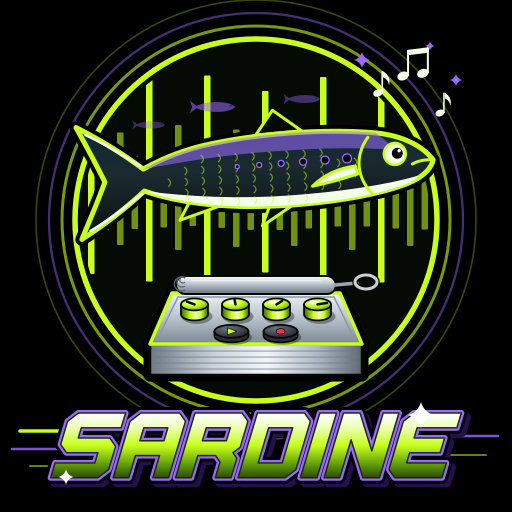
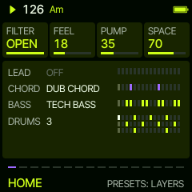
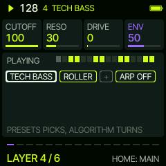
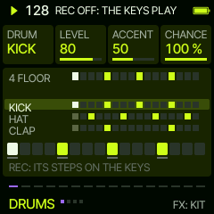
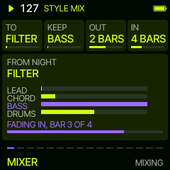
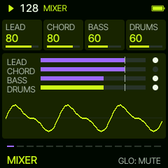
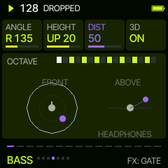

**Patched for FM-1 units with the new chipset.**

**[Quick cheat sheet](docs/CHEATSHEET.md): every way to change the sound, and how.**

# Sardine

Live club mixing for the FM-1, four layers packed in one can.

Sardine is a custom firmware for the M-VAVE FM-1. Four layers, always there: LEAD, CHORD, BASS and DRUMS. PRESETS
takes you from one to the next, FX through a layer's pages, and HOME back to all of them playing. A layer's sound acts
at once; its pattern, steps and modifiers (FAST, SLOW, REV, EVERY, THIN, EUCLID, SHIFT, LEN, OCT, PLY) wait, in the
second colour, until SEQ drops them in on the one.

Every start is a fresh groove in one of twenty club styles, from slow dark NIGHT to GABBER. You play it like a DJ
plays records: drop new lines in on the one, break it down and bring it back, swap parts, blend into the next style.
All sounds are synthesised; no samples.

## Try it, install it

Version 0.8.48:

- **[Try it in the browser](https://delirioux.github.io/sardine/try/)**: the whole firmware, the FM-1's screen and
  controls, sound and all, before you install anything.
- **[Install it on the FM-1](https://delirioux.github.io/sardine/install/)** from Chrome or Edge (Web MIDI), with the
  FM-1 on USB.
- The `dev` branch's test build: [try](https://delirioux.github.io/sardine/dev/try/),
  [install](https://delirioux.github.io/sardine/dev/install/).

Installing firmware is at your own risk; Felucca's [installer](https://hugelton.github.io/Felucca/webapp/installer/)
puts Felucca itself back. Sardine reports itself as `FM-1_47727346`.

## The top ten

1. **STYLE MIX** (GLO held): blend into another style like a DJ. The bass or kick plays on, the rest fades out, the
   new style fades in around it, in a key next door, at your volumes, the tempo gliding along.
2. **Every start a fresh groove**: other sounds, patterns, kit and key, every time; any time again with SEQ held.
3. **Twenty styles**, each with its own tempo, kits, bass, chords, and two leads and lead lines of its own.
4. **Tunes, not loops**: four-bar phrases (A A A' B), a PART B with its own lines and chords, A/B by itself, and
   EVOLVE reworking each part while it rests, so it never plays the same twice.
5. **LIVE**: build a mix from a lone kick or a soft pad, a layer at a time on SEQ, or every 8 or 16 bars by itself.
6. **Held moves** from any page: fill, BREAK (the drums back one by one after a long one), SWEEP, WASH, THROW, TAPE
   STOP, WOBBLE.
7. **Ten RAVE leads** that stab, gate, sweep and scream in time with the tempo.
8. **PAN 3D** on headphones: a layer in front, behind, above you, or flying round your head.
9. **Fully synthesised**: 24 drum kits (four whose kick follows the chords), 145 synth sounds, no samples, no cymbals.
10. **MIDI OUT** over USB: each layer on its channel, the notes as they play, and its volume, cutoff and pan as CCs,
    straight into a DAW.

## Everything

**The layers**

- LEAD, CHORD and BASS: 145 synth sounds on Felucca's engines (bass, keys, pads, leads, FX, and an AMBIENT set of wide
  pads, dub stabs and a rumbling bass in a big hall), each with CUTOFF, RESO, DRIVE and ENV on its home page
- DRUMS: seven rows (KICK, SNARE, CLAP, HATS, TOMS, RIM, PERC) that never cut each other off, eight variations of each
  drum, 24 synthesised kits (four whose kick follows the chord progression); PERC is tambourine, bongo, wood block,
  cowbell, cabasa and zap; no cymbals, no samples
- 24 drum patterns and 54 synth patterns (16 of them lead melodies over 2 or 4 bars), straight, broken and triplet; FEEL swings them all together; ten modifiers
  (FAST, SLOW, REV, EVERY, THIN, EUCLID, SHIFT, LEN, OCT, PLY) bend any of them
- An arpeggiator on every synth layer, off until you want it: ten modes, triplet rates, up to four octaves
- Key, scale and ten chord progressions; every synth layer follows the chord

**Tunes, not loops**

- The synth layers phrase over four bars (A A A' B): bar 3 lifts, bar 4 answers on the root and leaves room for the fill
- Sixteen lead MELODIES over 2 or 4 bars, a call and its answer, moving with the chords; leads that hold their notes
- Every groove has a PART B, its own lines and chords: ALGORITHM on HOME, or by itself every 8 or 16 bars; a badge
  blinks before it turns; EVOLVE reworks each part while it rests; SEQ held on HOME renews the resting part at once
- MANUAL on any layer: Sardine changes nothing on it by itself (no phrases, B line, EVOLVE, INTRO or ARC); you play it
- LIVE: a mix built by hand, from the kick alone or a soft pad, a layer at a time on SEQ (or every 8 or 16 bars)
- STYLE MIX (GLO held): blend into another style like a DJ: keep the bass or kick, fade the rest out, the new style in
- Twenty styles, from NIGHT (slow and dark) to GABBER, a groove in one press; INTRO builds it up, ARC drops and lifts it (drawn on the STYLE page, the bars to the drop counting down)
- SONG: up to eight saved sets as sections, each for 4 to 64 bars, played in turn

**Live moves**

- Held: a drum fill (ENV, a different one each time, and each bar while you hold it), a BREAK that brings the drums back in on the 1 or, after four bars,
  one by one (ARP), a filter SWEEP (LFO)
- Held from any page: WASH (OCT-), THROW (OCT+), TAPE STOP (EDIT), WOBBLE (REC), FADE (PLAY: out over a bar, then
  stop); a tap still does the button's job
- A MIXER on GLO: every layer's volume, mute and solo on the knobs
- MIDI OUT over USB, a channel for each layer (or OFF): the notes as they play, with each layer's volume, cutoff and pan
  as CCs (7, 74, 10), and a page that shows what goes out
- The synth layers pump under the kick (PUMP), with REVERB, DELAY and WIDTH for the space they sit in
- GATE cuts a held pad to a rhythm; PAN sweeps; PAN 3D puts a layer in front, behind, above or flying around you (on
  headphones)
- The keys play the layer you are on, lit with what it plays, the notes as you press them (MENU's SNAP snaps them to
  the scale); on DRUMS they play the drum you picked
- EDIT: a step editor (STEP, LENGTH, NOTE, FILL) with ready fills; there the keys write the steps; on a drum, KNOB 4 solos it while you edit

**Every start a fresh groove** (other sounds, patterns, kit, key), and one any time with SEQ held; eight sets keep the
ones you want, LAST the last one.

## The controls

| Control | What it does |
| --- | --- |
| HOME | HOME, from anywhere; on HOME: VIEW (a scope per layer, what comes); held: MENU (HOME again: MIDI OUT) |
| PRESETS | HOME, LEAD, CHORD, BASS, DRUMS |
| FX | the layer's next page (MIX, MANUAL, …); on HOME: SPACE, then PARTS |
| SELECT | the tempo |
| ALGORITHM | the layer's pattern (waits for SEQ); on HOME: PART A or B |
| SEQ | drops what waits, on the next bar line; in a LIVE build, the next layer; held: a whole new groove (on HOME: the part resting new) |
| EDIT (or REC) | the pattern editor: the only place the keys change a pattern |
| SCL / SAVE | the key and the chords / the sets |
| ENV / ARP / LFO | held: fill / BREAK / SWEEP |
| OCT- / OCT+ / EDIT / REC | held: WASH / THROW / TAPE STOP / WOBBLE |
| GLO | MIXER, MUTE, SOLO, STYLE, LIVE, SONG; held: STYLE MIX |
| PLAY | start / stop; held: fade out over a bar, then stop |

## Two minutes in

1. Press PLAY: a fresh groove, drums, chords and bass; the lead comes in after the first pattern.
2. Turn FILTER, FEEL, PUMP and SPACE on HOME: the whole mix, at once.
3. PRESETS to a layer, ALGORITHM for another pattern, SEQ to drop it in on the one.
4. On DRUMS, KNOB 1 picks the drum, KNOB 2 its variation; the keys play it.
5. Hold ARP for a break, let go for the drop; hold ENV for a fill.
6. SAVE keeps it in one of eight sets.

## Live workflows

Ways to get a set going. Each one works on top of whatever is playing.

**A track that keeps moving.** HOME, FX twice: PARTS. Turn **A/B** to 8 BARS and **EVOLVE** to LIGHT. The groove now
swaps between its two parts every 8 bars, and each part comes back a little different: a new bass line, other
hats or a new lead line (MORE: two of them, and now and then new chords). The **A>B** badge at the top blinks on the beats two bars before a turn, fast in the last bar: that is
your moment for a fill (hold ENV) into it. Want a big change? Hold **SEQ** a second on HOME: the part that is resting
gets all new lines and chords, and comes in on the next turn.

**From one style into another.** Hold **GLO**: STYLE MIX. **TO** the next style, **KEEP** BASS, **OUT** 2 bars, **IN** 4
bars, then **SEQ**. The drums, chords and lead fade out over two bars with the bass rolling on; the new style fades in
around it, drums first, in a key next door and with the tempo gliding over; at the end the bass swaps too. Keep KICK
instead for a techno-style blend, NOTHING for a clean change.

**Build it up from nothing.** GLO five times: **LIVE**. Pick a style, **START** KICK, **BUILD** HAND, then SEQ and PLAY.
Only the kick plays. Every SEQ brings the next layer in on the 1: hats, bass, clap, chords, the lead last. Or set BUILD
to 8 BARS and let it build itself while you ride the filter.

**Break it down, drop it back.** Hold **LFO**: the filter closes over two bars. Hold **ARP** with it: BREAK, the drums
and bass out. Hold it four bars or more, then let go on the 1: the drums come back in one by one over two bars. Hold
**OCT-** in the last bar for WASH (everything into the reverb) and let go on the drop.

**Play the sounds live.** On a layer's home page **CUTOFF**, **RESO**, **DRIVE** and **ENV** act at once. On HOME, turn
**RESO** up (HOME SPACE) and ride **FILTER** down for the filter-house sweep. FX to the layer's MIX page and turn
**INSTR**: a new sound on the same line, straight away. Turn **ARP** on for a CHORD or LEAD, **GATE** a pad to a rhythm,
or put the LEAD on **PAN 3D** ORBIT and listen on headphones. Hold **REC** for WOBBLE on the eighths, **OCT+** to throw
the last notes into the delay.

**Take a layer by hand.** On a layer, FX to **MANUAL** and turn it ON. From then on Sardine leaves that layer alone:
no phrase changes, no PART B line, no EVOLVE or NEW, no INTRO, ARC or LIVE holding it out. It plays exactly what it
has; change it yourself with ALGORITHM, EDIT or the keys, or set its pattern OFF and play it on the keys alone. Sardine
keeps the rest of the groove moving around you. A new groove or style keeps which layers are MANUAL.

**End it.** Hold **PLAY**: it blinks, and the whole mix fades out over one bar and stops. A tap still stops at once.

**A set of your own.** SAVE the grooves you like into sets 1 to 8. GLO to **SONG**: each step a set and how many bars
it plays; SONG ON plays them in turn, each one in on its bar line. Turn knobs, drop lines and do the moves on top.

**Into the DAW.** HOME held, then HOME again: **MIDI OUT**. LEAD on 1, CHORD on 2, BASS on 3, DRUMS on 10 (General MIDI
drum notes). Record the four channels: every note with its velocity and length, and each layer's volume, cutoff and
pan as CC 7, 74 and 10 as you ride them.

## More

The [manual](docs/MANUAL.md) has every screen; [BUILDING.md](BUILDING.md) builds it yourself; [the road to
1.0](docs/ROADMAP.md) what is left.

## Credits

Sardine runs on [Felucca](https://github.com/hugelton/Felucca), Leo Kuroshita's firmware for the FM-1, by way of [Sill](https://github.com/delirioux/sill)
and [Tuna](https://github.com/delirioux/tuna). See [CREDITS.md](CREDITS.md) and [LICENSING.md](LICENSING.md).

## License

GPL-3.0, see [LICENSE](LICENSE).
