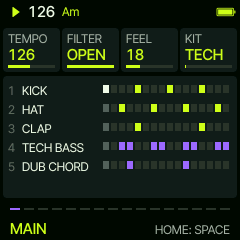
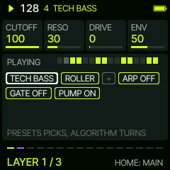
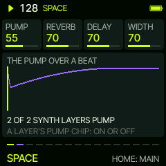
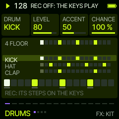
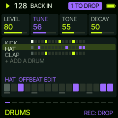
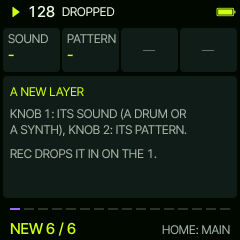

# Sardine manual

Sardine 0.5. Live club mixing on the FM-1: a stack of layers, each a line of code you build with the knobs. A layer
is a sound and a pattern, bent by modifiers and, on a synth layer, an arpeggiator. You change the code, and REC drops
your changes in on the one: the next bar line. The sound of a layer (its filter, drive, level) and the mutes act at
once, as you turn.

## The screens

SELECT goes through them: **MAIN**, **DRUMS** (every drum on one screen), then one screen per synth layer, then
**NEW** (a new synth layer, while there is room for one).

**MAIN** shows the whole stack: every layer, what it plays this bar, the muted ones crossed out. Its knobs act at
once: **TEMPO**, **FILTER** (the whole mix darker to the left, OPEN at the top), **FEEL** (the swing of the off
sixteenths; every layer follows it) and **KIT** (the drum kit).

**HOME on MAIN** turns it to **SPACE**, HOME again back: **PUMP** (how deep the synth layers duck under the kick),
**REVERB**, **DELAY** and **WIDTH** (at 70 each sound has its own sends and stereo spread; lower dries and narrows the
mix, higher opens it up). The pump follows the kick layer's hits as they play: mute the kick, or give it a broken
pattern, and the pump follows. The drums never duck. On a synth layer the last chip, **PUMP ON / OFF**, lets that
layer stay out of it (at once, not code).

## DRUMS

Every drum is a row of one screen: its name, its bar, its first modifier. **PRESETS** picks a row; the row picked
shows large under the rows, its 16 steps. **The 16 lowest keys are those steps**: a key puts a hit on, the same key
takes it off. While DRUMS is open the step keys glow dim and the steps that are set glow full, so you see which key is
which. The first edit makes the ready pattern the row's own (its name says EDIT); **ALGORITHM** turns the row to
another ready pattern (and lets the own one go). The keys above the 16 play the row's drum.

The knobs: the row's **LEVEL**, and the kit's **TUNE**, **TONE** and **DECAY**. **FX** mutes the row at once.

The last row, **+ ADD A DRUM**: ALGORITHM picks a drum (KICK SNARE CLAP HAT OPEN HAT RIDE CRASH RIM TOM LOW TOM CONGA
COWBELL CLAVE SHAKER) in a pattern that suits it. Until REC drops it in, ALGORITHM still changes which drum it is.

**EDIT** opens the row picked as a layer screen: its modifiers, or REMOVE. EDIT again goes back to DRUMS.

## A synth layer

**A layer** has two halves. The knobs below are its sound, at once:

| Layer | KNOB 1 | KNOB 2 | KNOB 3 | KNOB 4 |
| --- | --- | --- | --- | --- |
| synth | CUTOFF | RESO | DRIVE | ENV (the filter envelope, 50: the sound's own) |
| drum (from DRUMS, EDIT) | LEVEL | TUNE | TONE | DECAY |

A drum's TUNE, TONE and DECAY move the whole kit: every drum plays on it.

The panel is its code, as chips: **SOUND**, **PATTERN**, up to four **modifiers**, **+** (room for one more) and, on
a synth layer, **ARP**. PRESETS picks a chip, ALGORITHM changes it. A changed chip turns the second colour, the header
counts what waits (**2 TO DROP**), the panel shows the bar as it plays and as it will after REC. Press **REC**: the
header says **ON THE 1** and REC blinks; on the next bar line it all goes in at once. Stopped, REC drops at once.

**FX** mutes the layer open (at once; again: back in). Turning SOUND down past its first entry says **REMOVE**: the
layer goes on the drop.

## STEPS

On a synth layer **SEQ** opens STEPS: the layer's notes over the bar. **KNOB 1** picks the step, **a key** writes its
note there (snapped to the scale) and the cursor moves on to the next step, so a line goes in as fast as you play it;
the same note again takes the step off. **KNOB 2** is the step's length. On a chord layer (stabs, pads) a key puts the
chord on the step or takes it off: it plays the chord of the bar, so it follows the progression. The keys of the scale
glow dim, the step's note full. As on DRUMS the first edit makes the pattern the layer's own, the edits wait for REC,
and the modifiers and the arpeggiator still act on it. SEQ again goes back.

## GATE

On a synth layer **ENV** opens GATE: the layer's volume cut to a rhythm on the sixteenths while its notes are held, so
a pad pulses without a new attack each time. **KNOB 1** picks a ready gate (16THS, 8THS, OFFBEATS, PULSE 4, TRANCE A,
TRANCE B, DOTTED, SYNCO, BREATH, STUTTER, HALVES, SPARSE, or OFF), **DEPTH** how far it closes, **WIDTH** how much of
each step it stays open, **SMOOTH** how soft its edges are. **The 16 lowest keys are its steps**, lit as on DRUMS: a key
turns a step on or off, and the ready gate becomes your own. The gate follows FEEL, and it is code: it drops with REC.
The layer's GATE chip turns through the ready gates too. ENV again goes back.

## PAN

On a synth layer **LFO** opens PAN, at once like the layer's sound: **MODE** FIXED (where PAN says), SWEEP (from side
to side and back over **RATE**, a quarter bar to four bars), PING-PONG (each note on the other side) or RANDOM (each
note somewhere in the width); **PAN** the centre, **WIDTH** how far it moves. The drums all play on one part, so the
kit stays in the middle. LFO again goes back.

## The modifiers

They act in order, each on what the ones before it made, and on time itself, not on single steps:

| Modifier | What it does |
| --- | --- |
| FAST 2 3 4 | the pattern 2, 3 or 4 times in a bar |
| SLOW 2 3 4 | the pattern over 2, 3 or 4 bars |
| REV | the bar backwards |
| EVERY 2..8: REV | every 2nd .. 8th bar backwards |
| THIN 10..90 % | leaves that many of the notes out (the same ones each time) |
| EUCLID 1..15/16 | that many hits spread as evenly as they go over the bar, the pattern's notes on them |
| SHIFT -8..+7 | the pattern later or earlier by sixteenths |
| LEN 3..15 | the first 3..15 sixteenths, over and over: against a 16-step layer it drifts and comes back |
| OCT -2..+2 | octaves (synth layers) |
| PLY 2 3 4 | each note 2, 3 or 4 times in its own length |

## The arpeggiator

On a synth layer, **ARP** opens its page: **MODE** (UP, DOWN, UP-DOWN, DOWN-UP, CONVERGE, DIVERGE, RANDOM, THUMB,
PINKY, STRUM), **RATE** (1/4 to 1/32, with 1/8 and 1/16 triplets), **RANGE** (1 to 4 octaves) and **GATE**. It plays
the chord of the bar over the notes the pattern holds, so it is always in key; it swings with FEEL. ARP again goes
back. The arpeggiator is code too: it drops with REC.

## The key and the chords

**SCL** opens the KEY page: **KEY**, **SCALE** (MINOR, DORIAN, PHRYGIAN, MAJOR), **CHORDS** (ten progressions, from
ONE CHORD to four chords) and **BARS** (each chord 1, 2 or 4 bars). Every synth layer follows the chord of the bar;
the drums do not. A key change is code: it drops with REC, on the one. SCL again goes back.

## A new synth layer

Turn SELECT past the last synth layer: **NEW**. KNOB 1 picks its sound (BASS, KEYS, PADS, LEADS, FX, AMBIENT: 81 of them),
KNOB 2 its pattern. Up to three synth layers, each with its own sound and filter (the FM-1 runs four parts); every drum
plays on the kit. Up to twelve layers in all, drums and synths together.

## The keys

The keys play the layer open, live, snapped to the scale; on MAIN the first synth layer. On DRUMS and STEPS they edit
the steps (above). OCT- and OCT+ move their octave. The keys never change a setting.

## AMBIENT

The last sixteen sounds are for wide, deep club nights: pads (WIDE PAD, DARK PAD, GLASS, VAPOR, SWELL, NIGHT, DRONE
PAD, SKY, TAPE PAD, CHOIR AIR), dub stabs with long tails (DUB STAB, SPACE STAB, ECHO CHORD), RUMBLE (a low bass sent
into the hall), DEEP SUB and AIR LEAD. Each spreads its voices across the stereo field and has its own reverb and
delay. The room every layer plays in is a big hall; the drums send little into it.

## The kits

All synthesised: TECH, HOUSE, DEEP, HARD, BOOM, TIGHT, AFRO, DUSTY, CLASSIC.

## MENU

HOME held: the colour (SHOAL by default, and Felucca's) and the look (FLAT, LINE).

## MIDI out

The synth layers' parts on channels 1, 2 and 3, the kit on 10 with General MIDI notes.

## Saving

The layers and the settings save themselves two seconds after the last change while stopped, never while playing
(writing the flash would stall the audio). They live in Felucca's first song slot. (0.2 keeps its layers in a new
form: what 0.1 saved is not read, the first groove comes back.)
