# Sardine manual

Sardine 0.8.34. Live club mixing on the FM-1: four layers, always there, each one on or OFF: **LEAD**, **CHORD**,
**BASS** and **DRUMS**. A layer is a sound and a pattern, bent by modifiers. Its sound, filter, pan and level act at
once, as you turn; its pattern, steps and modifiers wait, in the second colour, until **SEQ** drops them in on the
one: the next bar line.

Every start is a fresh groove: other sounds, patterns, kit, key and tempo, ready to play. What you want to keep goes
into one of eight sets (SAVE, below).

## Finding your way

| Control | What it does |
| --- | --- |
| HOME | HOME, from anywhere; held: MENU (HOME again: MIDI OUT) |
| PRESETS | HOME, LEAD, CHORD, BASS, DRUMS: a layer always opens on its home page |
| FX | the layer's next page; past the last, back to its home page |
| SELECT | the tempo, everywhere |
| ALGORITHM | the layer's pattern (OFF first); it waits for SEQ. On HOME: PART A or B |
| SEQ | drops what waits, on the next bar line (stopped: at once); nothing waiting, a LIVE build: its next layer in; held a second: **a whole new groove**, as at power-on (on the next 1); on HOME: **the part resting new** (below) |
| REC | on a layer: its EDIT (on GATE: the gate's steps on the keys); held: WOBBLE (below) |
| SCL | the key and the chords, again: back |
| SAVE | the sets, again: back |
| EDIT | the layer's pattern editor, again: back; held: TAPE STOP (below) |
| ENV | held: a drum fill (below) |
| ARP | held: BREAK (below) |
| LFO | held: SWEEP (below) |
| GLO | GLOBAL: the MIXER, each press its next page (MUTE, SOLO, STYLE, LIVE, SONG), past the last back; held: **STYLE MIX** (below) |
| PLAY | start, stop |
| OCT- OCT+ | the keys' octave (the one it moved to lit); held: WASH, THROW (below) |

The footer shows the layer, a dot for each of its pages (the one open lit) and what the next press does.

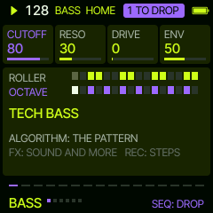

## A live mix, step by step

1. Before PLAY: **GLO** five times to **LIVE**. Pick a **STYLE**, a **START** (KICK for the floor, PAD for a soft
   opening) and **BUILD** (HAND to ride it yourself). **SELECT** sets the tempo, **SCL** the key.
2. **SEQ**: the mix is set up, the START waiting. **PLAY**.
3. Let it run 8 or 16 bars, then **SEQ**: the next layer comes in on the 1. Again every phrase or two: the floor fills.
4. Ride it on HOME: **FILTER**, **FEEL**, **PUMP**, **SPACE**. On a layer, **ALGORITHM** for another pattern, waiting
   for SEQ like the build (a pattern waiting drops first).
5. Tension: hold **LFO** (SWEEP) or **REC** (WOBBLE) over a bar or two; hold **ENV** for a fill into the 1.
6. The drop: hold **ARP** (BREAK) four bars or more, let go: the drums come back one by one. Or **OCT-** held (WASH) into
   it, dry on the 1.
7. Somewhere else: **ALGORITHM** on HOME to PART B, its own lines and chords, on the next phrase.
8. Keep what works: **SAVE** to a set. The end: hold **OCT+** (THROW) and stop, or **EDIT** (TAPE STOP).

## HOME

Every layer playing: LEAD, CHORD and BASS with their sound and their bar, DRUMS a thin bar for each drum; an OFF layer
shows its sound dimmed and OFF, a muted one is crossed out. The knobs act at once: **FILTER** (the whole mix darker to the left, OPEN at the top), **FEEL**
(the swing of the off sixteenths), **PUMP** (how deep the synth layers duck under the kick; each layer's own share on its PUMP page) and **SPACE** (the room:
reverb and delay together; at 70 each sound has its own). **FX** on HOME turns the knobs over to **RESO** (resonance on the whole mix's
filter, over each synth layer's own: ride FILTER down with it up for the filter-house sweep) and **WIDTH** (the stereo
spread, 70: each sound's own) on **HOME SPACE**; FX again **HOME PARTS**: **PHRASE**, **A/B** and **EVOLVE** (below);
FX again back.

### Phrases, PART A and B

The synth layers play in four-bar phrases, the way a tune is built: A A A' B. Bar 3 lifts its second half a step (each
chord tone to the next, an own note a step up the scale), bar 4 answers: LEAD's first note of its second half lands on
the chord's root and is held, nothing after it; BASS and CHORD leave the last beat empty, room for the drum fill, and
the bass's last note is the root. **PHRASE** (HOME, FX) OFF plays every bar as written.

Every groove has two parts. **PART B** is each synth layer's second line (another of its kind: another lead line,
bass line, stab or pad; in a STYLE, the style's other line), busier hats and a progression of its own. **ALGORITHM**
on HOME turns PART to A (left) or B (right): playing, it comes in on the next phrase (the header shows A, >B, B, B>A);
stopped, at once. **A/B** (HOME, FX) OFF, 8 or 16 bars: the parts take turns by themselves. While B is picked,
ALGORITHM on a layer page picks that layer's B line (the top shows it) and KEY's third knob is **B CHORDS**; both wait for
SEQ like any pattern. An edited (own) pattern is A's; B plays its line, or A's when B is "as A". An older set
gets a B made from its A when it loads. PART goes back to A when a set comes in.

**Keeping it moving.** **EVOLVE** (HOME PARTS) OFF, LIGHT or MORE: each time a part goes to rest it is reworked while
it is silent, so it comes back other: LIGHT one layer a new line of its kind (LEAD, CHORD, BASS, the hats, or the toms,
rim or perc row), MORE two, and now and then new chords. The kick, snare and clap stay (the backbone), and so do your own
edited patterns, layers waiting for SEQ and layers that are OFF. With A/B every 8 bars and EVOLVE on, it never loops
the same. **SEQ held a second on HOME** does it all at once, by hand: the part resting (B while A plays, A while B
plays) gets new lines on every layer it can, and new chords (the header: NEW B). If no change is coming it says CUE IT:
ALGORITHM on HOME cues it, or A/B brings it. SEQ held on any other page is still a whole new groove.

When PART is about to change (cued, or A/B by itself), a badge at the top of every page says which way, **A>B** or
**B>A**: two bars before, it blinks on the beats; in the last bar, on the eighths. The next 1 is the change.

## LEAD, CHORD, BASS

At the top of a layer's pages its pattern and its bar, the step playing lit (under it, in the second colour: what SEQ
drops). Its home page shows the sound's name and, across the bottom, the scope: the sound as it plays, a wave (a flat
line when it is silent). A layer opens on its home page: **CUTOFF**, **RESO**, **DRIVE**, **ENV** (the filter envelope, 50: the sound's own),
at once. ALGORITHM turns its pattern: OFF, then the patterns of its kind (BASS the bass lines, CHORD stabs and pads,
LEAD lead lines and the bass lines). FX turns through its pages:

| Page | KNOB 1 | KNOB 2 | KNOB 3 | KNOB 4 | |
| --- | --- | --- | --- | --- | --- |
| MIX (the first) | VOLUME (fades it in and out) | TYPE (BASS KEYS PADS LEADS FX) | INSTR (the sound, by name; the header says it whole) | MUTE | at once |
| ARP | MODE (OFF, UP, DOWN, UP-DOWN, DOWN-UP, CONVERGE, DIVERGE, RANDOM, THUMB, PINKY, STRUM) | RATE | RANGE | GATE | waits for SEQ |
| PAN | MODE (FIXED, SWEEP, PING-PONG, RANDOM; from FIXED: SWEEP from C, WIDTH 100, a bar) | PAN | WIDTH | RATE (SWEEP) | at once |
| PAN 3D | MODE (OFF FIXED ORBIT RANDOM FLY; on: ORBIT, 2 bars, level, DIST 10) | ANGLE (FIXED) or RATE (ORBIT, FLY) | HEIGHT | DIST | at once |
| PUMP | DEPTH (of HOME's PUMP) | RELEASE | SOURCE (KICK, BEAT) | PUMP ON / OFF | at once |
| GATE | a ready gate (or OFF) | DEPTH | WIDTH | SMOOTH | waits for SEQ |
| MOD | MOD 1 | MOD 2 | MOD 3 | MOD 4 | waits for SEQ |

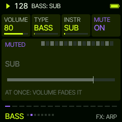
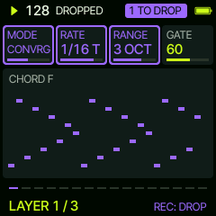
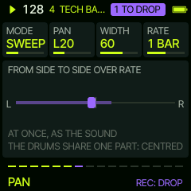

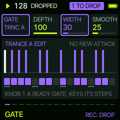
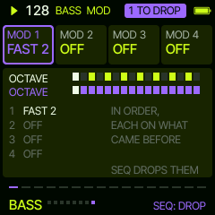

**PAN 3D** places the layer around you, for headphones: from above (FRONT up) the dot is the layer, near you or far; beside
it, from the side, its height; the dot moves as the layer does. **MODE**: FIXED (where ANGLE says), ORBIT (round you
over RATE, a quarter bar to four bars), RANDOM (each note somewhere else round you) and FLY (an orbit rising and
falling about HEIGHT). Turned on from OFF (MODE, or any of the knobs) it starts as ORBIT over two bars, level
(HEIGHT 0), near (DIST 10). On, the angle pans the layer, behind sounds a touch darker and softer, below darker, above brighter, far quieter, darker and wetter, and
the layer narrows to a point. These are cues the ear reads, not a measured head model: left, right and far come across
best; front against back and up against down are subtler and differ from one listener to the next. On speakers it is
panning and tone.

**PAN or PAN 3D**, one at a time on a layer: both move it left and right. PAN is on when it moves (SWEEP, PING-PONG,
RANDOM) or sits off the centre; PAN 3D when its MODE is not OFF. While one is on the other's cards are greyed, its knobs
do nothing, and its page says why and what to do: PAN 3D OFF first to use PAN; PAN back to FIXED, C, to use PAN 3D.

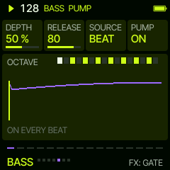

**PUMP** is how this layer ducks: HOME's PUMP is the whole mix's amount, DEPTH this layer's share of it. A sound's
type sets its DEPTH when you pick it: PADS 100 %, KEYS 80 %, BASS 50 %, LEADS 10 %, FX 0. RELEASE is how fast it comes
back (50: over most of a beat), SOURCE whether it follows the kick layer's hits (KICK: mute the kick and it stops) or
every beat (BEAT). The drums never duck.

Every synth layer has an arpeggiator: OFF until you turn MODE. Turned on from OFF it starts as PINKY at 1/8, one octave,
gate 70; turn on from there (left for UP and the rest). It plays the chord of the bar over the notes the pattern holds,
so it is always in key, and swings with FEEL. GATE cuts a held chord to a rhythm by its volume, without a new attack.

## Steps (REC)

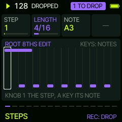
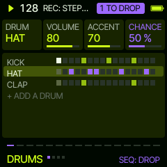

The keys change a pattern only in **EDIT** (below); everywhere else they play. **REC** on a layer opens its EDIT, and on
the GATE page turns the gate's steps on the keys (the 16 lowest) on and off. The first edit makes the pattern the
layer's own (MY STEPS); like a pattern, the steps wait for SEQ, and the modifiers still act on them.

## EDIT

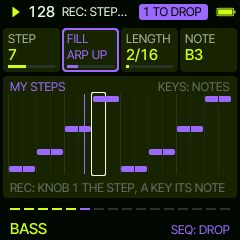
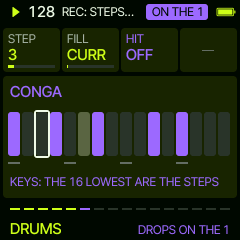

**EDIT** on a layer opens its pattern editor: its 16 steps, the step **KNOB 1** is on framed. **KNOB 2** is **FILL**:
CURR (the pattern as it was when you opened EDIT) and ready fills that rewrite the steps; turn back to CURR and the
pattern is as it was. On DRUMS: ROLL (the last beat in sixteenths), BUILD, SNARE, BREAK (the first half only), STUTTER,
GALLOP, FLAM and DOUBLE, over the drum's own hits or in place of them. On LEAD and BASS ready lines in the key: ROOT
8THS, ARP UP, ARP DOWN, OCTAVES, WALK, RIFF, CALL, PULSE 16. On CHORD the chord's rhythm: STABS, OFFBEATS, PUSH,
PULSE, 8THS, 16THS, DOTTED, HOLD. **KNOB 3** is the step's LENGTH (on DRUMS its HIT, on or off); turned below 1, the
note goes. **KNOB 4** is its **NOTE**: on an empty step it puts a note there (the note before it, else the root), turned
on it moves it up or down the scale (on CHORD: right the chord on, left off).

Setting a note, step by step: **EDIT**, KNOB 1 to the step, then a key (heard as you press it; the step moves on) or
KNOB 4 to the note, KNOB 3 for how long.

In EDIT, LEAD, BASS and CHORD: a key writes at the framed step (the note snapped to the scale, the same note
again takes it off; on CHORD the chord) and the frame moves on. DRUMS: the 16 lowest keys are the steps, glowing dim,
the hits set full; a key turns its step on or off, the keys above play the drum. Like a pattern, the steps wait for SEQ. EDIT again goes back.

## DRUMS

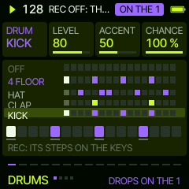
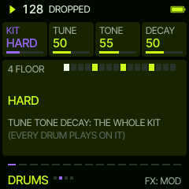

Seven rows, always there, each on a drum channel of its own, so no two ever cut each other off:

| Row | INSTR |
| --- | --- |
| KICK | KICK |
| SNARE | SNARE |
| CLAP | CLAP |
| HATS | HAT, OPEN HAT, SHAKER |
| TOMS | TOM, LOW TOM, CONGA |
| RIM | RIM, CLAVE |
| PERC | TAMB, BONGO, WOOD, COWBELL, CABASA, ZAP |

Every drum comes in eight variations, all on the INSTR knob: as the kit has it, **TIGHT** (short and bright), **ROOM**
(long and darker), **HIGH**, **LOW**, and the same drum from three other drum machines (**80**, **10**, **DEEP**),
whatever the kit: CLAP, CLAP TIGHT, CLAP ROOM .. CLAP DEEP, then (on HATS) OPEN HAT, OPEN HAT TIGHT and so on. The
header says the whole name as it turns. The PERC row's are the engine's own percussion on a channel of their own, never a kit's (TIGHT ROOM HIGH LOW DARK BRIGHT DEEP). No cymbals: a synthesised ride or crash never sounds right, so there are none. The claps are their own: all eight short hand claps (from the 80, 55, 77 and
66 machines and DEEP; CLAP 77 the 80 and 10 swapped for the 77), whatever the kit.

Each row shows its drum and its bar (the second colour: waiting for SEQ); a row OFF is dimmed. The home page: **DRUM**
(KNOB 1, the row), **INSTR** (its drum, at once), **VOLUME** and **ACCENT** (how hard the accented steps hit against
the rest; 50: as written). ALGORITHM turns the row's pattern, OFF first (its name in the header): a pattern turns
the row on, OFF turns it off; SEQ drops it in. A row that is muted, or not in yet in a LIVE build, shows its new
pattern lit all the same, and SEQ brings it in with it, unmuted (a synth layer too). Without REC every key plays the row's drum; with REC the 16 lowest keys are its steps, the keys above
play it.

FX: **MIX** (VOLUME, KIT, INSTR, MUTE), **KIT** (KIT, TUNE, TONE, DECAY: the whole kit, every drum plays on it) and
**MOD** (three modifiers, and **CHANCE**: how likely each hit plays, 100 % always; lower and hits drop out at random,
so the pattern changes as it plays). The kits, all synthesised: TECH, HOUSE, DEEP, HARD, BOOM, TIGHT, AFRO, DUSTY,
CLASSIC, ROOM, VINTAGE, MINIMAL, VOLT (electro), GARAGE, DISCO, BREAKS, DUB, LOFI, IRON (industrial), ACID, and four
loosely after the kits of two other FM-1 firmwares, HYP-1 and DUB-1, their kick tuned to the key's root: HYPNO (deep
and long), RUMBLE (hard and driven, a long dark tail), PUNCH (short and hard) and SOFT (a muffled thump).

## MOVES

Four more held moves, from any page. A tap on the button does its own job, as ever; held longer than a moment it is a
move for as long as you hold it (the header names it), its own job not done. They stack.

| Hold | Move |
| --- | --- |
| OCT- | **WASH**: everything into the reverb; let go and it comes back dry on the next 1 |
| OCT+ | **THROW**: everything into the delay, its feedback up; let go and the echoes ring out |
| EDIT | **TAPE STOP**: the whole mix slows down to a halt over a beat; let go and it plays on |
| REC | **WOBBLE**: the synth layers' filter rises and falls on the eighths, in time |

## MIXER

**GLO** opens the MIXER: a level for each layer, LEAD, CHORD, BASS and DRUMS (all the drums together), a row each, on the four
knobs, at once (70 out of the box; 80, the mark, is the sound as it is); the dot at the end lights as the layer plays. Under them the scope of the whole mix. **GLO** again turns the knobs over to their
MUTE, GLO again to their **SOLO** (turn right: that layer, with any others soloed, alone; left: back), GLO again
to STYLE (below), GLO again to SONG (below), GLO once more back. SOLO is a live move: not kept with the groove. A layer's VOLUME here is the same as on its own first FX page.

## The drum fill

Hold **ENV**: from the next beat the drums give way to a fill (ENV blinks until the beat, then stays lit), for as
long as you hold it; let go and the groove is back at once. Towards its end a fill dips the filter of the synth layers, the 1 opens it again. A fill is a bar: started
on beat 3 it plays from its third beat, so it always peaks on the bar's last sixteenth. Each time another, by turns:
ROLL (the snare in sixteenths, rising, 32nds at the end), TOMS (a run from the high tom down), BUILD (eighths, then
sixteenths, then 32nds, an open hat on top), STUTTER (kick and hat on every sixteenth, claps), FLAM (flammed
backbeats over ghost notes), SYNCO (3-3-2 accents, toms to end), CLAPS (claps building to 32nds) and GHOST (ghost
notes and rim around a flammed snare). They play the SNARE row's drum; the synth layers play on.

## BREAK and SWEEP

Hold **ARP** for a **BREAK**: the drums and the bass drop out at once, LEAD and CHORD play on. Let go and ARP blinks
until the next 1, where everything comes back in: the drop. Held 4 bars or more, the drums come back one by one over
two bars instead: the kick (and the bass) on the 1, then the hats, the perc, the rim, the snare on the second bar's
1, the clap, the toms. Hold **LFO** for a **SWEEP**: the whole mix's filter closes
over two bars (as far as FILTER at about 15), its resonance rising as it goes; let go and it is open again at once. Together with the fill on ENV: the
build, the fill and the drop.

## STYLE, INTRO and ARC

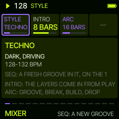

**GLO** four times: **STYLE**, **INTRO**, **ARC**. **KNOB 1** picks a style, **SEQ** makes a fresh
groove in it, on the next 1 (stopped: at once): its tempo, kit, scale, swing, pump, room and filter, a bass, a chord
and a lead of its kind, its drums. The style playing is fine too: SEQ makes a fresh groove in it. The STYLE card lights
when SEQ takes it and stays lit till the groove is in (so on LIVE and STYLE MIX).

| Style | | Style | |
| --- | --- | --- | --- |
| NIGHT | slow, dark, filtered (98-104) | DISCO | bright, strings and bass (116-120) |
| FILTER | French touch, filtered disco (122-126) | AFRO | afro house, percussive (120-124) |
| DEEP | warm, soft deep house (120-122) | GARAGE | 2-step, swung (130-134) |
| TECH | tech house, rolling (124-127) | BREAKS | broken beats, rave (128-132) |
| MINIMAL | sparse, clicky (124-126) | DUB | dub techno, echoes (118-122) |
| TECHNO | dark, driving (128-132) | AMBIENT | space, barely a beat (88-96) |
| HARD | hard techno (140-148) | ELECTRO | robotic, broken (126-130) |
| GABBER | hardcore, distorted (170-180) | HAPPY | bright, euro, hands up (138-142) |
| ACID | a 303 line (128-134) | LOFI | lo-fi house, dusty (116-120) |
| TRANCE | uplifting, wide (136-140) | PROG | progressive, building (122-124) |

**INTRO** (OFF, 4, 8, 16 bars): from PLAY the layers come in one by one, the kick first, the other drums at a quarter,
BASS at half, CHORD at three quarters, LEAD at the end, the filter opening over it. With INTRO OFF the LEAD still
waits one pattern (the chord progression once round, 4 to 8 bars) after PLAY, then comes in. Every new groove and
style has a lead. LEAD is polyphonic: its patterns are single lines, a chord on the keys sounds whole. **ARC** (OFF, 16, 32, 64 bars):
after the intro a cycle, the groove for half, a break (drums and bass out) for a quarter, a build (the filter closing)
for the last quarter with a roll on its last half bar, and the drop on the next 1. Both are kept with the groove.

## The modifiers

They act in order, each on what the ones before it made, and on time itself, not on single steps:

| Modifier | What it does |
| --- | --- |
| FAST 2 3 4 | the pattern 2, 3 or 4 times in a bar |
| SLOW 2 3 4 | the pattern over 2, 3 or 4 bars |
| REV | the bar backwards |
| EVERY 2..8: REV | every 2nd .. 8th bar backwards |
| THIN 10..90 % | leaves that many of the notes out (the same ones each time) |
| EUCLID 1..15/16 | that many hits spread as evenly as they go over the bar, the pattern's notes on them |
| SHIFT -8..+7 | the pattern later or earlier by sixteenths |
| LEN 3..15 | the first 3..15 sixteenths, over and over: against a 16-step layer it drifts and comes back |
| OCT -2..+2 | octaves (synth layers) |
| PLY 2 3 4 | each note 2, 3 or 4 times in its own length |

## LIVE

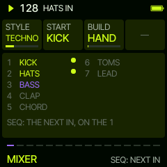

**GLO** five times: **LIVE**, a mix built by hand. **STYLE** (KNOB 1), **START** (KNOB 2): **KICK** (the kick alone),
**PAD** (a soft pad on CHORD, its filter low, nothing else) or **EMPTY** (silence), and **BUILD** (KNOB 3): **HAND** (you
bring each layer in) or every **8** or **16 BARS** by itself. **SEQ** sets it up: a fresh groove in the style, all of it
made, only the START playing; the rest waits, in an order that builds (KICK: kick, hats, bass, clap, snare, chord, perc,
rim, toms, lead; PAD: the pad, kick, bass, hats, clap, snare, lead, perc, rim, toms; layers that are off left out). The
page lists it: what is in lit, the next in the accent. Then **PLAY**, and **SEQ** on any page brings the next layer in on
the next 1, as long as nothing else waits to drop (that first). Stopped, SEQ brings it in at once. Loading a set or a new
groove ends the build.

## STYLE MIX

**GLO** held: **STYLE MIX**, from the style playing into another, as a DJ blends two records. **TO** (KNOB 1) is the
style to go to, **KEEP** (KNOB 2) what plays on through it (**BASS**, **KICK**, **BASS+KICK**, **DRUMS**, **BASS+DRUMS**
or **NOTHING**), **OUT** (KNOB 3) how long the rest takes to fade out (1, 2 or 4 bars), **IN** (KNOB 4) how long the new
style takes to fade in (2, 4, 8 or 16 bars). **SEQ** starts it on the next 1:

1. OUT: everything but what you keep fades out smoothly.
2. On the 1 after it, a fresh groove in the new style comes in around what you kept, still at the old tempo, in a key
   next door to the old one on the circle of fifths, as DJs mix: minor to major its relative major (A minor to C
   major), major to minor its relative minor, minor to minor or major to major a fifth up (A minor to E minor, the
   lift). The two keys share six of their seven notes; the kept layers follow the new chords. Its layers fade in one after another: the drums first, then BASS,
   CHORD and LEAD, all at full by the end of IN, while the tempo glides bar by bar to the new style's.
3. On the 1 after IN, what you kept becomes the new style's own too (the bass swap): the mix is over, MIXED.

Every fade goes from and to the volumes you set (each layer's VOLUME and mute, the MIXER's DRUMS), never past them:
the new style's layers come in at your levels, not at its own. The page shows each layer's level as it moves (the kept ones in the accent) and how far the mix is. Stopped, SEQ puts the
new style in at once. Loading a set, a new groove or another style ends a mix; PLAY stopping it mid-way finishes it.
GLO goes back.

## SONG

**GLO** six times: **SONG**, the sets as the sections of a song. Eight steps, each a set and its length: **STEP** (1 to 8),
**SET** (1 to 8, or END), **BARS** (4, 8, 16, 32, 64) and **SONG** (OFF, ON). ON, the steps play in turn, round and round:
each set comes in on its bar line (read a bar ahead), empty sets and END steps are passed. Stopped, SONG ON loads the
first step's set, PLAY starts the song from it; switched ON while playing, the first step comes in on the next 1. Out
of the box: sets 1 to 4, 16 bars each. The steps are kept (with the look); SONG itself starts OFF.

## The key and the chords

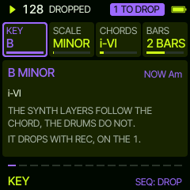

**SCL** opens KEY: **KEY**, **SCALE** (MINOR, DORIAN, PHRYGIAN, MAJOR), **CHORDS** (ten progressions, from ONE
CHORD to four chords) and **BARS** (each chord 1, 2 or 4 bars). The synth layers follow the chord of the bar; the
drums do not. The progressions are named as in the minor key; where a scale makes one of their chords diminished
(DORIAN's VI, MAJOR's VII, MINOR's ii, PHRYGIAN's v) the chord a third below plays instead, so nothing sounds off. A key change waits for SEQ. SCL again goes back.

## The keys

The keys play the layer open, live, snapped to the scale (on HOME: LEAD); the header says what, briefly (KEYS: LEAD,
SAW LEAD). On LEAD, CHORD and BASS the keys light up with the notes the layer plays (a bass line folded up into
the keys' reach). On DRUMS every key plays the drum picked, and its own note (its General MIDI note, moved into
the keys' reach) is lit. With REC they write its steps. They never
change a setting.

## SETS

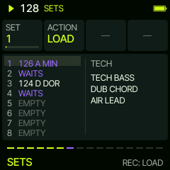

**SAVE** opens SETS: eight grooves kept in the flash and **LAST** (L), a row each with its tempo and key; beside the
rows, what the set picked holds (its kit, its synth sounds). **KNOB 1** (or PRESETS) picks a set, **KNOB 2** the action,
**REC** does it:

| Action | What REC does |
| --- | --- |
| LOAD | the set in, on the one while playing (at once when stopped); what waited for SEQ goes |
| STORE | what plays into the set (over what was there) |
| NEW | a fresh groove, as at a start, on the one |
| CLEAR | the set empty |

The flash is written only while stopped: a STORE or CLEAR while playing is kept and written as you stop (the row says
WAITS; one set at a time). SAVE again goes back.

**LAST** keeps itself: three seconds after a change, stopped (and three seconds after you stop), the groove as it is
goes into LAST. It never comes back on its own, but LOAD brings it back. STORE and CLEAR leave it alone. Every set
stays as it is until you STORE over it or CLEAR it, and loads as often as you like. A set stored with 0.6 loads into
the layers by its sounds: a bass sound to BASS, keys and pads to CHORD, leads and FX to LEAD.

## AMBIENT

The last sixteen sounds are for wide, deep club nights: pads (WIDE PAD, DARK PAD, GLASS, VAPOR, SWELL, NIGHT, DRONE
PAD, SKY, TAPE PAD, CHOIR AIR), dub stabs with long tails (DUB STAB, SPACE STAB, ECHO CHORD), RUMBLE (a low bass sent
into the hall), DEEP SUB and AIR LEAD. Each spreads its voices across the stereo field and has its own reverb and
delay. The room every layer plays in is a big hall; the drums send little into it.

## LEADS of the styles

Every STYLE has two lead sounds and two lead lines of its own, picked for its music (a fresh groove takes one of
each): SOFT LEAD (a warm triangle, DEEP, PROG, GARAGE, DUB, LOFI), FILTER LEAD (a resonant saw that talks with ENV,
FILTER), BLIP (a short square into the echo, TECH, MINIMAL), DARK SAW (a saw on a sub, low and driven, TECHNO),
ACID LEAD and RUBBER (squelching, gliding, ACID and TECHNO), PLUCK LEAD (a plucked saw into a long delay, TRANCE,
PROG, MINIMAL), RAVE LEAD (a wide pulse, BREAKS, HAPPY), SCREECH (a driven saw, HARD, GABBER), DUB LEAD (a soft
triangle drowned in echoes, NIGHT, DUB), STRING LEAD (a chorused string line, DISCO), PAN FLUTE (breathy, DEEP, AFRO,
AMBIENT, LOFI) and VOX CHOP (a short sung vowel, FILTER, TECH, GARAGE). The singing ones (SOFT LEAD, FILTER LEAD,
DUB LEAD, STRING LEAD, PAN FLUTE, and FLUTE, WHISTLE, AIR LEAD, VOX LEAD) get a vibrato a third of a second into a
held note.

The lead lines: TONES UP, RIFF, PLUCKS, CALL, HOLD NOTE, HOLD CHORD, and HOOK (a one-bar tune), ECHOES (three notes
the delay answers), BLIPS (three short ones), ANTHEM (sixteenths over the chord, trance), SQUELCH (an acid line
jumping octaves), DISCO RUN (octaves), TWO NOTES (two long ones) and UPBEATS (on the offbeats).

### RAVE

Ten wild leads for the peak of the night, at the end of the LEADS: STORM (detuned squares that stab, a bite of pitch
on each hit), TWISTER (the same held, chopped in sixteenths), BUZZSAW (a driven pulse, its width moving by the
eighth), SIREN (a synced saw screaming as its sync sweeps over two bars), ZAPPER (each note falls an octave as it
hits), WOBBLER (the filter wobbling by the eighth), POWER (three saws in fifths and octaves), HYPERSAW (three wide
detuned saws), TORNADO (a noisy square, the filter rising and falling over four bars) and STROBE (chopped in 32nds).
The tempo moves them all. Their line is RATTLE: sixteenths hammering the root, up to the fifth and the octave at the
end. HAPPY plays STORM, BREAKS HYPERSAW, both now and then with RATTLE.

## MENU

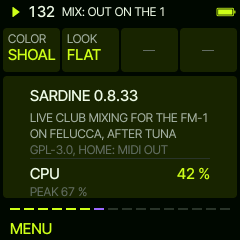

HOME held: the colour (SHOAL by default, and Felucca's) and the look (FLAT, LINE). Below them the **CPU**: the audio's load
now (its average over a tenth of a second; above 85 % it turns the second colour), its PEAK since the start, and how
many voices the load guard had to let go (SHED), if any. HOME: MIDI OUT.

## MIDI OUT

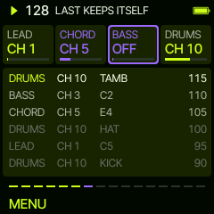

**HOME** held opens the MENU; **HOME** once more turns to **MIDI OUT**, and once more back HOME. MIDI OUT: the channel each layer sends its notes on over USB,
LEAD, CHORD, BASS and DRUMS on the four knobs (1 to 16, or OFF: that layer sends nothing). Out of the box LEAD 1,
CHORD 2, BASS 3, DRUMS 10, at every start (a channel set OFF comes back on). Under them what went out, the newest on top: the layer, its channel, the
note (a drum by its name) and its velocity. The drums go out as General MIDI notes (PERC's as the nearest: TAMB 54,
BONGO 60, WOOD 76, COWBELL 56, CABASA 69, ZAP 80).

The notes go out as they play: their velocity (the accents, the phrases, the drum rows' LEVEL and ACCENT, the fills'
ghost notes and flams, a STYLE MIX's drum fades) and their length, swung by FEEL. Beside them, on each layer's channel,
three controllers as the layer sounds, sent whenever one changes (and all of them as a host connects):

| CC | What | From |
| --- | --- | --- |
| 7 (volume) | the layer's level | its VOLUME, mute and SOLO, a STYLE MIX's fade; DRUMS: the MIXER's DRUMS |
| 74 (cutoff) | a synth layer's filter | CUTOFF, HOME's FILTER, SWEEP, WOBBLE, the fills' dip, PAN 3D |
| 10 (pan) | a synth layer's place | PAN (SWEEP, PING-PONG, RANDOM) or PAN 3D |

The PUMP is not sent: a DAW's sidechain does it better.

MIDI in: notes (and CC 7, 10, 74) that come in on a channel Sardine sends a layer on are dropped: they are its own coming back (a DAW
passing through what it gets) and would play again on another layer's sound. Play Sardine from outside on a channel
it does not send on.

## Saving

A start is a fresh groove; what you keep goes into SETS, and the last groove into LAST by itself. The colour and the
look are kept.
